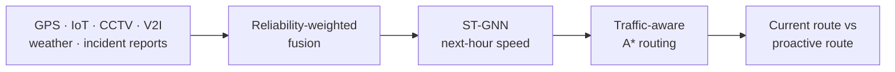

# Predicting Traffic Patterns for Autonomous Vehicles

An interactive Streamlit prototype that predicts near-future traffic with a **Spatio-Temporal Graph Neural Network (ST-GNN)** and uses the prediction to plan routes **proactively** with traffic-aware **A\***, rerouting *before* congestion builds up rather than after.

> **Note:** all data is simulated, and the system is a decision-support prototype. It recommends routes; it does not control a vehicle.

## Pipeline



1. **Multi-source data:** four simulated speed sensors with different noise levels and random missing readings, plus rain intensity and incident reports.
2. **Fusion:** a reliability-weighted average over whichever sources reported at each time and intersection.
3. **Prediction:** the ST-GNN reads the last 8 hours of traffic on the road graph and predicts each intersection's speed for the next hour.
4. **Routing:** A\* finds the lowest-cost path using predicted speeds, congestion, and incident exposure.
5. **Comparison:** the route chosen on *current* traffic and the route chosen on *predicted* traffic are evaluated under the same predicted conditions, so the time saved is a like-for-like comparison.

## Quick start

Requires Python 3.7+.

```bash
git clone https://github.com/Darknite0707/NNDL-predicting-traffic-patterns-for-autonomous-vehicles.git
cd NNDL-predicting-traffic-patterns-for-autonomous-vehicles
pip install -r requirements.txt
streamlit run app.py
```

Then open http://localhost:8501. On first load the model trains for about 15 seconds; after that it is cached.

## Using the dashboard

**Sidebar**

- **Start / Destination:** the trip to plan across the 12-intersection network.
- **What-if incident:**
  - *Auto (best demo):* automatically picks the incident that best demonstrates proactive rerouting for the chosen trip.
  - *Manual:* choose the incident node and severity yourself.
  - *None:* plain prediction with no incident.

**Tabs**

| Tab | Shows |
|---|---|
| Network & Routes | Road graph coloured by predicted congestion, with the current route (blue) and the predicted route (orange dashed) |
| ST-GNN Prediction | Test-set accuracy against a baseline, per-node speed history with predictions, and the predicted state of every intersection |
| Multi-Source Fusion | Each source's error and missing rate compared with the fused signal |
| A\* Route Analysis | Edge-by-edge cost breakdown for each route |
| Data | The unified multi-source dataset |

## How it works

### Simulated traffic

The simulator generates 60 days of hourly speeds for 12 intersections. Speeds combine a daily rush-hour cycle, local variation, slower downtown nodes, rain, and random incidents. An incident report at hour *t* slows traffic at hour *t + 1*, at the incident node and (to a lesser degree) its neighbours. This one-hour lead is what makes proactive routing possible.

### Fusion

| Source | Reliability weight | Noise (std, km/h) |
|---|---|---|
| GPS | 0.95 | 1.3 |
| IoT | 0.90 | 1.8 |
| CCTV | 0.82 | 2.3 |
| V2I | 0.93 | 1.0 |

About 2.5% of each source's readings are dropped at random. The weights are renormalised over the sources that did report, and the fused signal is more accurate than any single source.

### ST-GNN model

```
input [batch, 8 hours, 12 nodes, 5 features]
  → GraphConv → GraphConv      (spatial: spillover between neighbouring intersections)
  → GRU per node               (temporal: how each node's traffic evolves)
  → linear head                (change from the last observed speed)
```

The inputs are fused speed, incident reports, rain intensity, and time of day (sine and cosine).

The model is trained on the first 80% of the timeline and evaluated on the last 20%, against simulated ground truth:

| Model | MAE (km/h) | RMSE (km/h) | MAPE |
|---|---|---|---|
| ST-GNN | 1.71 | 2.22 | 4.5% |
| Persistence (repeat last value) | 2.23 | 3.09 | 5.9% |

These are results on simulated data, not real-world accuracy.

### Routing

Each road's A\* cost is:

```
cost = travel time
     + 0.5 × congestion × travel time
     + 4 min × incident exposure
```

The heuristic is straight-line travel time at free-flow speed (60 km/h). It never overestimates, so A\* returns the optimal path. The dashboard reports travel time in minutes separately from the A\* cost, which is an optimisation score.

## Project structure

```
app.py             Streamlit app: simulation, fusion, ST-GNN, routing, UI
requirements.txt   Python dependencies
```

## Limitations

- All sensor data, incidents and weather are simulated.
- The road network is a small 12-node grid.
- Predictions are one hour ahead.
- The what-if incident is a controlled demonstration, not a live incident feed.

Possible next steps: real sensor feeds (for example the METR-LA or PeMS datasets), multi-step forecasting, and larger road networks.
